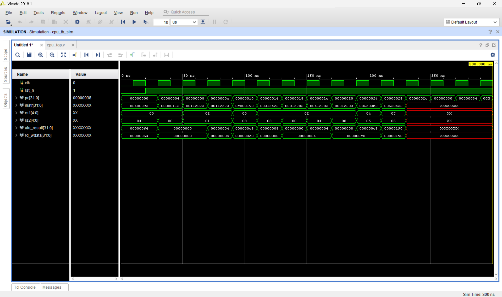

# Single-Cycle RV32I RISC-V CPU

A single-cycle CPU implementing a subset of the RV32I (32-bit RISC-V base integer) instruction set, in Verilog/SystemVerilog. Reuses the ALU design from this portfolio's standalone `configurable_alu` project. Verified against an independent Python instruction-level golden model, with a minimal custom assembler for writing and running test programs.

## Features

- Single-cycle datapath: fetch, decode, execute, memory, writeback complete in one clock cycle
- R-type, I-type (ALU/load/JALR), S-type, B-type, U-type, and J-type instruction support (see `docs/isa_spec.md` for the complete, exact coverage)
- 32x32-bit register file with correct `x0`-hardwired-to-zero behavior
- Reused, extended ALU (ripple-carry adder, same design as `configurable_alu`, plus SLT/SLTU)
- Independent Python golden model (instruction-level RV32I interpreter) for verification
- Minimal custom RV32I assembler (`tb/asm_to_hex.py`) for writing test programs in assembly

## Module Hierarchy
cpu_top (top-level single-cycle datapath)
├── instr_fetch (PC register, next-PC selection: sequential/branch/jump)
├── instr_memory (instruction ROM, loaded via $readmemh)
├── instr_decode (field extraction, immediate generation)
├── control_unit (opcode/funct3/funct7 -> all datapath control signals)
├── regfile (32x32-bit register file, x0 hardwired to zero)
├── alu (+ alu_adder, alu_logic, alu_shift - reused from configurable_alu)
└── data_memory (word-addressed data RAM for LW/SW)


See `docs/isa_spec.md` for exact instruction coverage, `docs/microarchitecture.md` for the datapath diagram and design rationale, and `docs/design_decisions.md` for the key design choices (including a real bug found and fixed during development).

## Verification: Golden Model Approach

`tb/riscv_golden_model.py` is an independent, instruction-level RV32I interpreter written directly from the ISA specification, not derived from the RTL. Test programs are written in assembly (`tb/test_programs/*.asm`), assembled to machine code by a minimal custom assembler (`tb/asm_to_hex.py`), then run through both the golden model and the RTL simulation - with the RTL's final register file state checked against the golden model's independently-computed expected state.

## Test Programs

| Program | Coverage |
|---------|----------|
| `basic_arith.asm` | R-type/I-type ALU ops, shifts, comparisons, negative immediates, LUI, AUIPC |
| `branches.asm` | Taken branches (BEQ, BLT) and JAL with return-address capture |
| `load_store.asm` | SW/LW round-trip verification across multiple memory offsets |
| `coverage_extra.asm` | The 14 instructions the other programs do not run (ANDI, ORI, XORI, SLTI, SLTIU, SRAI, SLL, SRL, SRA, BNE, BGE, BLTU, BGEU, JALR); every branch is tested both taken and not taken, and JALR jumps to an odd address to check that bit 0 is cleared |

All four programs pass with every register (x1-x31) matching the golden model exactly, and together they execute all 31 implemented instructions (the first three programs alone cover 17 of 31). Results were obtained with Vivado 2018.1 (first three programs) and reproduced with Vivado 2023.1 (all four). Coverage is by instruction, not by operand value.

## How to Run
```bash
cd sim
./run.sh
```

This script:
1. Assembles all `.asm` test programs to `.hex` machine code
2. Runs each program through the Python golden model to compute expected final register state
3. Compiles and runs the RTL against each program with Xilinx Vivado's simulator
4. Compares the RTL's final register file state against the golden model's expected state, reporting PASS/FAIL per register

Waveforms are saved in `sim/results/`.

## Example Waveform



*Captured in Vivado's simulator for the `load_store` program: PC incrementing through fetched instructions, with rs1/rs2 register reads, ALU result, and the writeback value visible as each instruction executes.*

## Synthesis

```bash
cd synth
vivado -mode batch -source cpu_synth.tcl
```

Produces timing, area, and power reports in `synth/reports/` (synthesis only, no clock constraint, so the timing figure there is only an estimate before placement).

For a constrained run through place and route:

```bash
cd synth
PERIOD=10 vivado -mode batch -source cpu_impl.tcl
```

Results (Vivado 2023.1, Artix-7 xc7a35tcpg236-1, out-of-context mode, instruction memory pre-loaded with `basic_arith.hex`):

| Clock target | Worst setup slack | Result |
|---|---|---|
| 10 ns (100 MHz) | +0.150 ns | timing met |
| 8 ns (125 MHz) | -0.539 ns | timing not met |

After place and route at 10 ns the core uses 906 LUTs (4.36%) and 358 registers (0.86%); the estimated power is 0.097 W (vector-less, medium confidence). About 79% of the 9.843 ns critical path is routing delay. These figures are for a fixed program in instruction memory (unused register-file bits are optimised away), out-of-context mode (no clock tree or I/O), and no board test. The maximum frequency lies between 100 and 125 MHz and was not searched further. See `docs/design_decisions.md` Section 8 for the discussion, including the lesson that the first synthesis attempt produced zero cells until debug output ports were added.

## Repository Structure

riscv_cpu/
├── rtl/
│ ├── cpu_top.v # Top-level datapath
│ ├── cpu_pkg.sv # Shared opcode/ALU-op/immediate-format definitions
│ ├── instr_fetch.v # PC register, next-PC logic
│ ├── instr_decode.v # Field extraction, immediate generation
│ ├── control_unit.v # Instruction decode -> control signals
│ ├── regfile.v # 32x32-bit register file
│ ├── alu.v # Top-level ALU (reused from configurable_alu)
│ ├── alu_adder.v # Ripple-carry adder/subtractor
│ ├── alu_logic.v # AND/OR/XOR
│ ├── alu_shift.v # SLL/SRL/SRA
│ ├── instr_memory.v # Instruction ROM
│ └── data_memory.v # Data RAM (word-addressed)
├── tb/
│ ├── cpu_tb.sv # Main testbench
│ ├── riscv_golden_model.py # Independent Python ISA-level reference model
│ ├── asm_to_hex.py # Minimal RV32I assembler
│ └── test_programs/ # Assembly test programs (4)
├── sim/
│ ├── run.sh
│ └── results/
├── synth/
│ ├── cpu_synth.tcl # Synthesis only
│ ├── cpu_impl.tcl # Constrained synthesis + place and route
│ └── reports/
├── docs/
│ ├── isa_spec.md # Exact instruction coverage
│ ├── microarchitecture.md # Datapath diagram and design rationale
│ └── design_decisions.md # Key design choices, including a real bug found and fixed
└── README.md